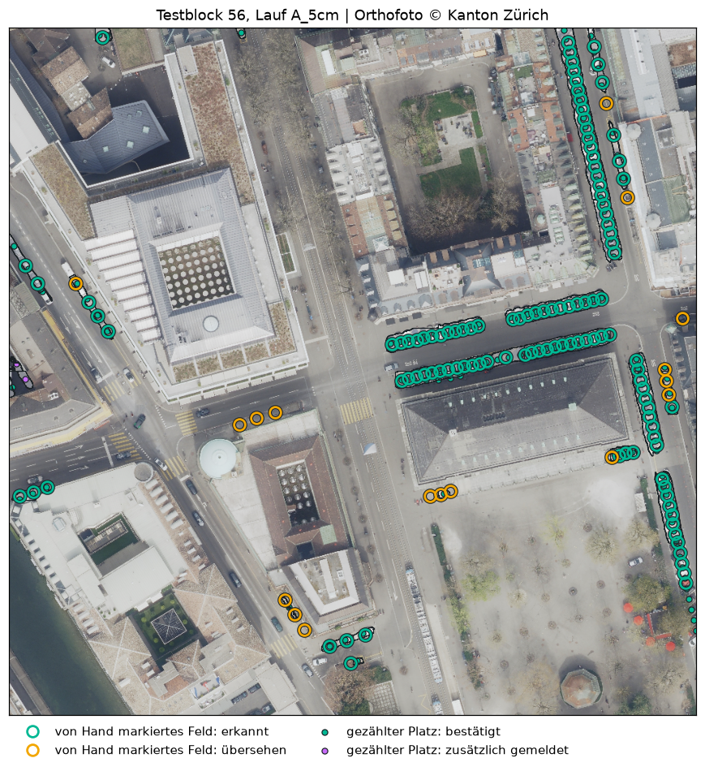

# Parkplatz-Erkennung Zürich: Pilot 5 cm vs. 10 cm

**Version 0.2.0-alpha (27.11.2026).** Privates, nicht kommerzielles Projekt. Die Ergebnisse sind nicht amtlich und nicht für Planungs- oder Rechtsentscheide geeignet (siehe [Haftungsausschluss](#haftungsausschluss)).

## Was die Arbeit will

Die Frage: **Wie gut lassen sich aufgemalte Parkfelder in der Stadt Zürich (Kreis 1) aus Luftbildern zählen, und was bringt eine Auflösung von 5 cm gegenüber 10 cm?**

Daraus sind drei Fragen geworden, festgelegt vor dem Rechnen (Leitfaden [01b](notebooks/01b_methodik_leitfaden.ipynb), Abschnitt 3):

1. Wie gross ist das Delta zwischen der Zählung aus dem Luftbild und den amtlichen Daten desselben Jahres?
2. Werden Parkfelder im laubfreien Bild (Frühjahr 2021) besser erkannt als im belaubten (Sommer 2024/25)?
3. Was bringen 5 cm je Bildpunkt gegenüber 10 cm?

Es ist ein Versuch ohne Zielwert: Berichtet wird, was herauskommt, mit den bekannten Grenzen.

## Was die Arbeit macht

1. **Lösung von Hand setzen.** Der Autor des Projekts (in den Notebooks «Auftraggeber» genannt) hat in Kreis 1 3'269 Felder auf den Luftbildern markiert und jedes für beide Bilder beurteilt (zum Beispiel sichtbar, verdeckt, unsicher). Darunter sind 2'669 Einzelfelder, 361 Sonderfelder mit `✕` (Taxi, Polizei, Feld mit Kreuz), 30 mit `?` (Invalidenparkplatz) und 209 Abschnitte von Parkstreifen ohne einzelne Felder. Das ist die Ground Truth; sie dient zum Lernen und zum Prüfen.
2. **Aufteilen, bevor gelernt wird.** Das Gebiet besteht aus 691 Ausschnitten von 51,2 m in 62 Blöcken: 38 Blöcke zum Lernen, 9 zum Einstellen (Validieren) und 15 zum Prüfen (Testen). Die Testblöcke sieht das Netz beim Lernen nie.
3. **Lernen.** Ein neuronales Netz (Dense-U-Net) lernt, welche Bildpunkte Parkfläche sind: je ein Netz für zwei Luftbilder (Frühjahr 2021 ohne Laub, Sommer 2024/25 mit Laub) und zwei Auflösungen (5 cm und 10 cm).
4. **Zählen.** Die gemeldete Fläche geteilt durch die Fläche eines Platzes ergibt die Anzahl, je Ausschnitt.
5. **Vergleichen.** In den Testblöcken zweimal: mit der Ground Truth (zeigt den Fehler der Methode) und mit den amtlichen Daten desselben Jahres (zeigt das Delta).



*Ein Testblock im Bild vom Frühjahr 2021 bei 5 cm. Helle Flächen: was das Netz als Parkfläche meldet. Punkte: die daraus gezählten Plätze. Ringe: von Hand erfasste Felder, grün erkannt, gelb übersehen. Orthofoto © Kanton Zürich.*

Das Vorgehen übernimmt Verfahren aus der Forschung des DLR (Hellekes 2022, Henry 2021) und aus der Berliner Studie (Rauch 2025) und passt sie an Zürich an: Die Breite eines Platzes ist an der eigenen Ground Truth gemessen, die Tiefe stammt aus der Norm. Jeder Entscheid steht mit Datum im Leitfaden `01b`; die gültige Methode mit allen Formeln steht dort in Abschnitt 12. Die Quellen stehen in [DATEN_LIZENZEN.md](DATEN_LIZENZEN.md), Abschnitt 5.

## Was herauskommt

Grundlage: 15 Testblöcke mit 137 Ausschnitten. Sie wurden vor dem Lernen per Zufall festgelegt (Seed 42) und einmal ausgewertet; für einen Lauf gibt es zusätzlich eine zweite Auswertung als Gegenprobe (siehe unten).

| Bild und Auflösung | IoU Parkfläche | Genauigkeit / Trefferquote | Fehler je Ausschnitt (MAE) | zum Vergleich: "überall 0" | gezählt gegenüber Ground Truth | Delta: Methode gegen amtlich (Strassenraum im Gebiet; 95-%-Intervall) |
| --- | --- | --- | --- | --- | --- | --- |
| Frühjahr 2021, 5 cm | 0,62 | 0,78 / 0,75 | 0,86 | 5,17 | 664 von 708 (−6 %) | 351 gegen 354 (−0,8 %; −5,1 bis +3,3 %) |
| Frühjahr 2021, 10 cm | 0,58 | 0,77 / 0,70 | 1,11 | 5,17 | 626 von 708 (−12 %) | 336 gegen 354 (−5,1 %; −14,8 bis +2,7 %) |
| Sommer 2024/25, 5 cm | 0,57 | 0,76 / 0,69 | 0,85 | 3,65 | 454 von 500 (−9 %) | 258 gegen 275 (−6,2 %; −30,1 bis +17,4 %) |
| Sommer 2024/25, 10 cm | 0,49 | 0,74 / 0,59 | 1,26 | 3,65 | 395 von 500 (−21 %) | 210 gegen 275 (−23,6 %; −59,7 bis −0,5 %) |

**Antworten auf die drei Fragen**

1. **Delta zu den amtlichen Daten** (Methode − amtlich, Strassenraum der Testblöcke): Frühjahr 2021: −3 Plätze bei 5 cm (−0,8 %) und −18 bei 10 cm (−5,1 %); Sommer 2024/25: −17 Plätze bei 5 cm (−6,2 %) und −65 bei 10 cm (−23,6 %). Ein kleines Delta heisst nicht, dass genau gezählt wurde: Es besteht aus drei Teilen mit verschiedenen Vorzeichen (Tabelle unten).
2. **Frühjahr gegen Sommer:** Im Frühjahrsbild sind in den Testblöcken 708 Felder sichtbar, im Sommerbild 500. Die Kennzahlen der Fläche sind im Frühjahrsbild höher: IoU bei 5 cm 0,62 gegen 0,57, Trefferquote 0,75 gegen 0,69. Für diesen Unterschied wurde kein Intervall gerechnet. Die beiden Versuche unterscheiden sich zudem nicht nur im Laub, sondern auch in Jahr, Sonnenstand, parkierten Autos und amtlichen Daten; der Unterschied lässt sich darum nicht dem Laub allein zuschreiben (Notebook 10, Grenzen).
3. **5 cm gegen 10 cm:**
   - Frühjahr 2021: Vorteil von 5 cm +0,25 Plätze je Ausschnitt (95-%-Intervall +0,06 bis +0,46): 5 cm zählt besser; das Intervall enthält die 0 nicht.
   - Sommer 2024/25: Vorteil von 5 cm +0,42 Plätze je Ausschnitt (95-%-Intervall +0,14 bis +0,66): 5 cm zählt besser; das Intervall enthält die 0 nicht.

**Was man dazu wissen muss**

- **Wo es etwas zu zählen gibt:** Rund die Hälfte der Testausschnitte hat kein sichtbares Feld; dort ist "0 gezählt" richtig, und das macht die MAE klein. Nur über die Ausschnitte mit Feldern (77 im Bild 2021 mit im Mittel 9,2 Feldern, 67 im Bild 2024/25 mit 7,5) beträgt die MAE 1,34 (2021, 5 cm), 1,82 (2021, 10 cm), 1,49 (2024/25, 5 cm) und 2,42 (2024/25, 10 cm) Plätze.
- **Untergrenze:** Die Zählformel allein, auf das perfekte Lösungsblatt der Testausschnitte angewendet, liegt je Ausschnitt 0,32 (2021) und 0,19 (2024/25) Plätze daneben.
- **Sonderfelder:** Felder mit `✕` (Taxi, Polizei, Feld mit Kreuz) und `?` (Invalidenparkplatz) zählen wie gewöhnliche Felder. Im Bild 2021 sind es 44 und 7 von 708 sichtbaren Feldern, im Bild 2024/25 30 und 5 von 500. Das Netz findet ihre Fläche schlechter: Trefferquote bei 5 cm 0,52 (2021) und 0,47 (2024/25), auf gewöhnlichen Feldern 0,76 und 0,71.
- **Gegenprobe zum Bild 2021 (Notebook 11):** Beim 10-cm-Netz war im ersten Lauf die beste Epoche die letzte (40 von 40); es war nicht belegt, dass es ausgelernt hatte. Es wurde darum noch einmal mit 60 Epochen gelernt (beste Epoche 55) und ein zweites Mal an den Testblöcken ausgewertet: IoU 0,583 statt 0,582, gezählt 624 statt 626 von 708, MAE 1,17 statt 1,11. Vorteil von 5 cm dann +0,31 Plätze je Ausschnitt (95-%-Intervall +0,13 bis +0,48). Die Aussage «5 cm zählt im Bild 2021 besser» ist damit bestätigt: Das Intervall enthält die 0 auch mit dem länger gelernten Netz nicht. Die Tabelle oben zeigt die erste Auswertung; sie bleibt das Ergebnis.
- **Einschränkung dazu:** Bis auf diese Gegenprobe wurde jedes Netz genau einmal gelernt. Das Intervall bildet nur die Auswahl der Testblöcke ab, nicht den Zufall beim Lernen. Das 10-cm-Bild ist zudem aus dem 5-cm-Bild gerechnet.
- **Lernen:** Bei allen vier Läufen war die Lernkurve im letzten Viertel der Epochen flach (Notebook 07, Abschnitt 8). Bei `A_10cm` ist die beste Epoche trotzdem die letzte; nach dem Leitfaden (`01b`, 7.4) ist dann nicht belegt, dass das Maximum erreicht ist. Im ersten Lauf wurde nicht verlängert; nachgeholt ist das als Gegenprobe (siehe oben).

**Woraus das Delta besteht.** Delta = Methode − amtlich, in Plätzen über alle Testausschnitte (Strassenraum im Gebiet). Die drei Teile ergeben zusammen das Delta:

| Lauf | Delta | 1. Fehler der Methode (Methode − sichtbare Felder) | 2. nicht sichtbar (verdeckt oder einzeln stehend) | 3. Ground Truth gegen amtlich |
| --- | --- | --- | --- | --- |
| `A_5cm` | −3 | −9 | −11 | +17 |
| `A_10cm` | −18 | −24 | −11 | +17 |
| `B_5cm` | −17 | −8 | −47 | +38 |
| `B_10cm` | −65 | −56 | −47 | +38 |

Die Teile haben verschiedene Vorzeichen und heben sich zum Teil auf. Die Herleitung mit Abbildung steht in [notebooks/10_auswertung.ipynb](notebooks/10_auswertung.ipynb), Abschnitt 6. Um Teil 3 einordnen zu können, hat der Auftraggeber 30 Felder beurteilt, die die Ground Truth im Strassenraum hat, die amtlichen Daten aber nicht ([notebooks/stichprobe_strassenraum.ipynb](notebooks/stichprobe_strassenraum.ipynb)). Im Bild 2021 sind davon 3 gewöhnliche Parkfelder, 13 reservierte oder private Felder (12 davon gelb markiert) und 10 gelbe Markierungen mit Kreuz (Parkverbot); der Rest ist anderes. Der Überschuss der Ground Truth besteht demnach vor allem aus gelben Markierungen und nicht aus Parkplätzen, die in den amtlichen Daten fehlen. Die Stichprobe ist klein, und mehrere Felder liegen in derselben Reihe.

**Grenzen.** 15 Testblöcke ergeben breite Unsicherheiten, und wenige Blöcke enthalten die meisten Felder. Die Ground Truth stammt aus einem Durchgang einer Person. Jedes Netz wurde einmal gelernt, eines für die Gegenprobe ein zweites Mal. Sonderfelder zählen mit und werden schlechter gefunden als gewöhnliche Felder. Das 10-cm-Bild ist aus dem 5-cm-Bild gerechnet. Einzeln stehende Felder, Streifen ohne Einzelfelder und unsichere Stellen sind nicht ausgewertet. Die vollständige Liste steht am Schluss von Notebook 10.

## Dashboard

[ergebnisse/dashboard/dashboard.html](ergebnisse/dashboard/dashboard.html) ist eine Karte für den Browser, mit einer Legende in Alltagssprache. Sie zeigt für ganz Kreis 1, welche Plätze die Methode zählt (Punkte), welche von Hand erfassten Felder sie erkennt oder übersieht (Ringe) und wo sie zusätzlich Parkfläche meldet. Umschalten lassen sich das Luftbild (2021, 2024/25) und die Auflösung (5 cm, 10 cm). Die Datei herunterladen und per Doppelklick öffnen; sie braucht eine Internetverbindung für die Luftbilder. Die gezählten Plätze gibt es je Lauf als GeoPackage in `ergebnisse/dashboard/daten/` (vier Ebenen, Schweizer Koordinaten LV95, EPSG:2056); was in den Ebenen steht, erklärt das Dashboard unter «Über diese Karte», Teil «Daten nutzen».

**Die Karte ist keine Prüfung.** In den Lernblöcken kennt das Netz die Stellen: Dort zählt die Methode 93 bis 108 % der sichtbaren Felder, in den Testblöcken 79 bis 94 %. Geprüft ist die Methode nur in den Testblöcken (Tabelle oben). Die Punkte auf der Karte verteilen die gezählten Plätze gleichmässig auf die gemeldeten Flächen; sie sind keine einzeln erkannten Felder. Gelbe Markierungen (Parkverbot, reservierte Felder) zählen mit. Die Regeln stehen in `01b`, Abschnitt 11.3, die Herleitung in den Notebooks 12 und 13. Das Dashboard verwendet Alltagswörter (zum Beispiel «Programm» für die Methode und «Prüfgebiet» für Testblock); die Zuordnung steht am Schluss von Notebook 13.

## Aufbau

| Ordner / Datei | Inhalt |
| --- | --- |
| `notebooks/` | Notebooks 00 bis 13 in fester Reihenfolge, didaktisch aufgebaut (vorher → Schritt → nachher, mit Bildern); dazu `01b` (Methodik, nur Text), das Werkzeug zum Erfassen der Ground Truth, ihre Prüfung und die Stichprobe im Strassenraum. Übersicht in [notebooks/README.md](notebooks/README.md) |
| `daten/ground_truth/ground_truth_hand.json` | die von Hand gesetzte Ground Truth (691 Ausschnitte, zwei Bilder) |
| `daten/ground_truth/stichprobe_strassenraum_urteil.csv` | Urteile des Auftraggebers zu den 30 Feldern der Stichprobe im Strassenraum |
| `daten/roh/MANIFEST.csv` | Liste aller Rohdaten mit Quelle, Lizenz und Prüfsumme. Die Rohdaten selbst sind nicht enthalten |
| `daten/verarbeitet/` | kleine Zwischenergebnisse: Aufteilung der Blöcke, Reihen und Platzmasse, Index der Kacheln |
| `ergebnisse/dashboard/` | das Dashboard (`dashboard.html`) und je Lauf ein GeoPackage mit den gezählten Plätzen (`daten/`) |
| `ergebnisse/` | Kennzahlen (CSV), Lernkurven und Protokoll des Lernlaufs, gewählte Schwellen, Abbildungen. Das MLflow-Protokoll (`mlflow.db`) entsteht beim Lernen lokal und ist nicht enthalten |
| `ml_pipeline/PIPELINE.md` | Protokoll nach der ML-Pipeline: Freigaben, 16 Schritte, Nachträge |
| `DATEN_LIZENZEN.md` | verwendete Daten, Literatur und Normen, Lizenzen |
| `PILOT1.md` | der erste Durchgang in Worten: was gemacht wurde, was herauskam, warum die Methode geändert wurde (ohne Quellcode) |
| `UMGEBUNG.md`, `requirements*.txt` | exakte Python-Umgebung |

## Nachrechnen

Voraussetzungen: Python 3.11 und eine NVIDIA-Grafikkarte mit 12 GB (getestet unter Windows 11 mit CUDA 12.8). Auf dem Rechner dieses Durchgangs belegen die Rohdaten rund 33 GB und die Zwischendaten rund 6 GB.

```bash
python -m venv .venv
.venv/Scripts/python -m pip install -r requirements-lock.txt --extra-index-url https://download.pytorch.org/whl/cu128
.venv/Scripts/python -m ipykernel install --user --name parkplatz

# Rohdaten einmalig laden: notebooks/rohdaten_herunterladen.ipynb
# alle Notebooks 00 bis 13 nacheinander, mit vollem Lernen und der Karte des ganzen Gebiets (etwa 2,5 h)
.venv/Scripts/python notebooks/nachtlauf.py --training
```

Unter Linux steht `.venv/bin/python` statt `.venv/Scripts/python`. Die Einzelheiten stehen in [UMGEBUNG.md](UMGEBUNG.md). Die gelernten Netze dieses Durchgangs liegen nicht im Repository (Dateien über 50 MB); mit `--training` werden sie neu gelernt. Wegen kleiner Rundungsunterschiede der Grafikkarte können die Zahlen dabei leicht abweichen.

**Anderes Gebiet.** Für ein anderes Gebiet braucht es eine eigene Ground Truth: `KREISE` in Notebook 00 ändern, Rohdaten laden und die Felder mit `ground_truth_erfassen` setzen. Erprobt ist das nicht. An einzelnen Stellen steht der Name `kreis1` noch fest im Code, zum Beispiel beim Lesen der Liegenschaften in den Notebooks 01 und 04.

## Versionen

| Version | Datum | Inhalt |
| --- | --- | --- |
| 0.2.0-alpha | 27.11.2026 | Dieser Stand: eigene, von Hand gesetzte Ground Truth als Lösung zum Lernen und Prüfen, zwei Luftbilder, 15 Testblöcke, Karte des ganzen Gebiets und Dashboard. Die amtlichen Daten dienen nur für das Delta |
| 0.1.0 | 26.11.2026 | Vorgänger, in den Notebooks «Pilot 1» genannt: amtliche DAV-Daten als Lösung, ein Luftbild, vier Testzonen. Überholt. Was gemacht wurde und was herauskam, steht in [PILOT1.md](PILOT1.md); der Quellcode von Pilot 1 ist nicht Teil dieses Repositorys |

«Alpha» heisst hier: Die Methode läuft von den Rohdaten bis zur Karte durch und ist einmal geprüft. Sie ist aber nur in Kreis 1 erprobt, mit einem Lernlauf je Variante und einer Ground Truth aus einem Durchgang einer Person. Als Beta-Version soll ein Stand gelten, der zusätzlich in einem zweiten Gebiet geprüft ist und bei dem das Lernen wiederholt wurde.

## Lizenzen

- **Code:** [MIT](LICENSE)
- **Texte, Abbildungen, Ergebnisse:** [CC BY 4.0](LICENSE-docs). Namensnennung: „Bl3ndii, parkplatz-erkennung-zuerich“.
- **Verwendete Daten:** Diese gehören den jeweiligen Anbietern. Eine vollständige Übersicht steht in [DATEN_LIZENZEN.md](DATEN_LIZENZEN.md).

Quellenangabe:
> Orthofoto: © Kanton Zürich, Orthofoto Frühjahr 2021, Sommer 2024/25 und Sommer 2026 (OGD). Parkplatzdaten und amtliche Vermessung: Stadt Zürich, Open Data (CC0). Hintergrundkarte: © OpenStreetMap-Mitwirkende.

Zitieren: siehe [CITATION.cff](CITATION.cff) oder „Cite this repository“ auf GitHub.

## Haftungsausschluss

Dieses Projekt ist eine private, nicht kommerzielle Arbeit. Code, Modelle und Ergebnisse werden **ohne jede Gewähr** bereitgestellt („as is“).

- Die Zahlen sind **Schätzungen eines Pilotmodells** mit bekannten, erheblichen Abweichungen (siehe oben). Sie sind keine amtlichen Angaben der Stadt oder des Kantons Zürich und ersetzen keine Erhebung vor Ort.
- Der Autor übernimmt keine Haftung für Schäden oder Folgen, die aus der Nutzung des Codes, der Modelle oder der Ergebnisse entstehen, soweit gesetzlich zulässig. Das gilt insbesondere für Analysen, Planungen und Entscheide, die darauf beruhen.
- Wer Code oder Ergebnisse verwendet, prüft sie selbst und ist für die Einhaltung der Lizenzen der Rohdaten verantwortlich.
- Das Projekt steht in keiner Verbindung zur Stadt Zürich, zum Kanton Zürich, zur DLR oder zu den Autorinnen und Autoren der zitierten Arbeiten.

## Entstehung

Konzept, Entscheide und Prüfung: Bl3ndii. Code und Dokumentation sind mit Unterstützung des KI-Assistenten Claude (Anthropic) entstanden.
